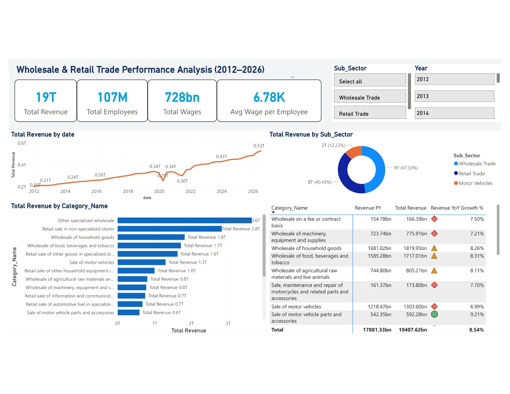

# 📊 Malaysia Services Sector: Revenue & Labor Productivity Dashboard (2012–2026)
 **Project Type**: Personal Portfolio Project | Data Analytics
 
## 📌 Project Overview
This Power BI dashboard provides an executive-level macroeconomic analysis of Malaysia's **Wholesale & Retail Trade sector** (based on MSIC 3-digit classification) from 2012 to 2026. It tracks key financial metrics, workforce dynamics, and labor efficiency to assist stakeholders in evaluating sector performance.

---

## 🔑 Key Metrics & Highlights
* **Total Revenue**: RM 881 Billion (2013 baseline)
* **Total Workforce**: 6.0 Million Employees
* **Total Wages**: RM 39 Billion
* **Average Wage per Employee**: RM 6.08K

---

## 🛠️ Tech Stack & Methods
* **Business Intelligence Tool**: Microsoft Power BI Desktop
* **Data Transformation**: Power Query
* **Data Modeling**: Star Schema (`services_group` Fact Table connected to `Dim_Group`)
* **DAX Formulas**: Time Intelligence (`YTD`, `PY Revenue`, `YoY Growth %`, `Avg Wage per Employee`)
* **Visual Design**: Executive Navy & Teal Theme, Conditional Formatting, Dynamic Slicers

---

## 📁 Repository Structure
* `Malaysia_Services_Sector_Dashboard.pbix` - Interactive Power BI File
* `Malaysia_Services_Sector_Dashboard.pdf` - Static Export / PDF Report
* `services_group.csv` - Raw Data Source (DOSM / MSIC Data)
* `Dashboard_Preview.png` - Visual Screenshot

---

## 👤 Author
* **Name**: Hannah Izzah 
* **LinkedIn**: www.linkedin.com/in/hannah-izzah-6b2b0a227
